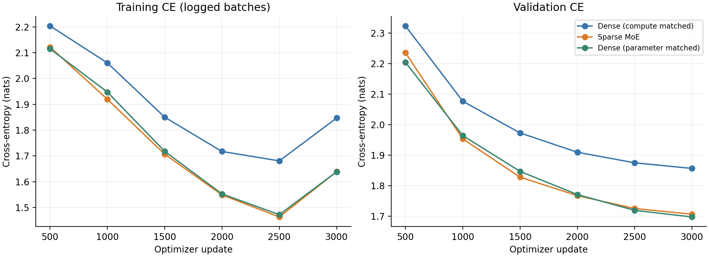
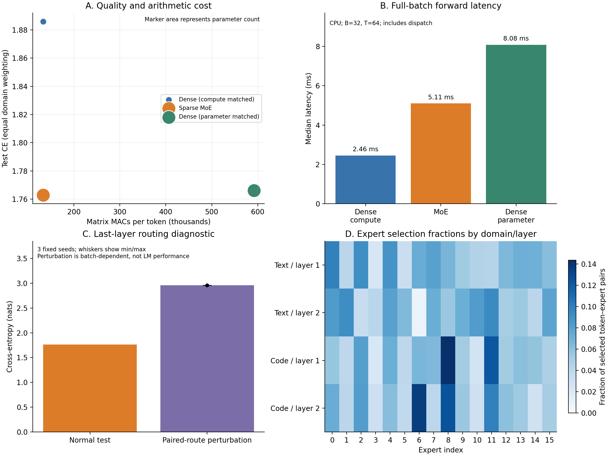

# Part Three: Task 1 and Task 2 — measured results

Seed 416; 3000 updates per model; batch 32; context 64; CPU; 4 threads. The supplied optimizer, schedule, sampling order, and validation-checkpoint rule were retained. Test evaluation uses disjoint full-length packs and equal domain weighting.

## Task 1

The official dispatch/gradient and prefix-invariance checks passed. Training CE below is the current batch at each logging point, not an epoch average.

## Task 2

| Model | Parameters | MACs/token | Text CE | Code CE | Test CE | Test PPL | Forward ms |
|---|---:|---:|---:|---:|---:|---:|---:|
| Dense (compute matched) | 139,024 | 133,120 | 1.9732 | 1.7985 | 1.8858 | 6.5919 | 2.458 |
| Sparse MoE | 603,264 | 133,120 | 1.8969 | 1.6289 | 1.7629 | 5.8292 | 5.107 |
| Dense (parameter matched) | 601,360 | 591,872 | 1.9068 | 1.6255 | 1.7661 | 5.8482 | 8.083 |

MoE has 4.34 times the compute-matched dense model's parameters at the same 133,120 matrix MACs/token. Its measured forward latency is 2.08 times as large. Arithmetic counts do not capture dispatch, gather/scatter, and small matrix-operation overheads.

MoE minus compute-matched dense test CE: -0.1230 nats. MoE minus parameter-matched dense test CE: -0.0032 nats. The dense parameter match differs from MoE by 0.316%.

Normal MoE test CE: 1.762883. Paired-route diagnostic CE mean: 2.958701; range across three seeds: [2.957595, 2.960190]; difference: +1.195818. Expert IDs and gates are exchanged jointly across sequences at the same position in the last layer. Expert–token counts are unchanged; both prefix-invariance checks passed. This is a batch-dependent checkpoint diagnostic, not standalone LM performance or a causal estimate of the benefit of routing during training.

Usage fractions show selection patterns across domains and layers; usage alone does not establish semantic specialization. These comparisons use one model seed and fixed updates/data order, not matched wall-clock time or convergence. Latencies are medians of 30 full-batch forwards after 10 warmups on the same CPU and include dispatch.

## Reproduction and provenance

Raw results: `language.json`; console logs: `training.log`, `diagnostics.log`; source hashes/environment and initial checks: `run_provenance.json`. The selected MoE checkpoint is `moe_seed416.pt`.

Run `python MoE/summarize_results.py` from the release directory to recreate this report and figures. Review these measured results and disclose AI assistance when incorporating them into your submission.
